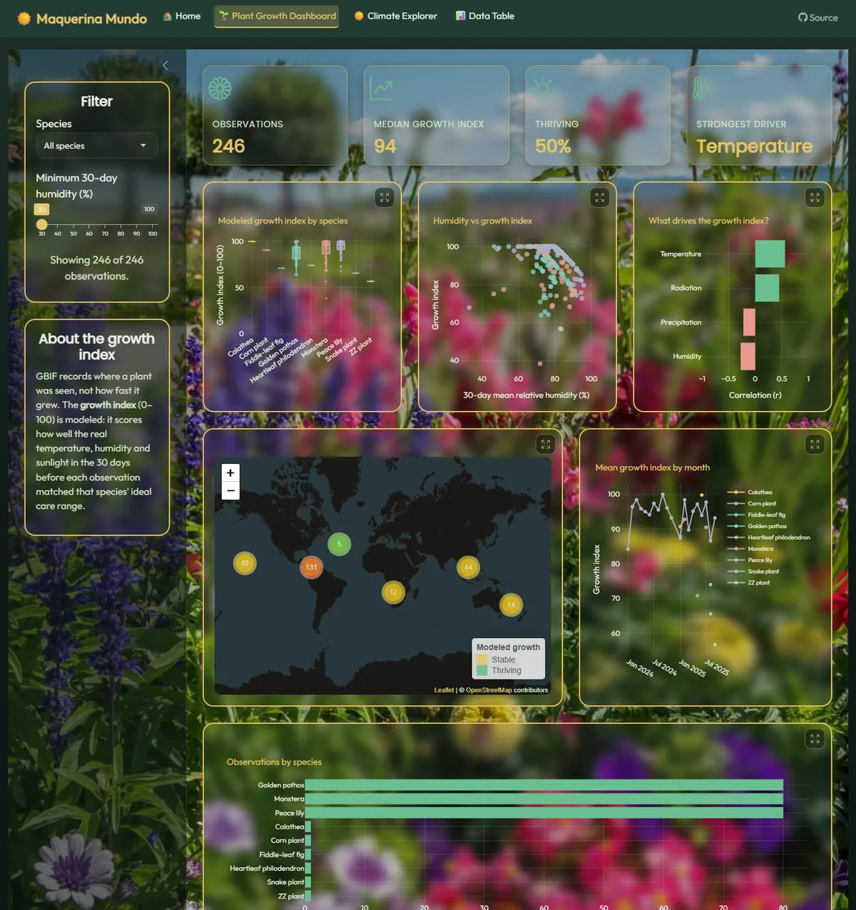
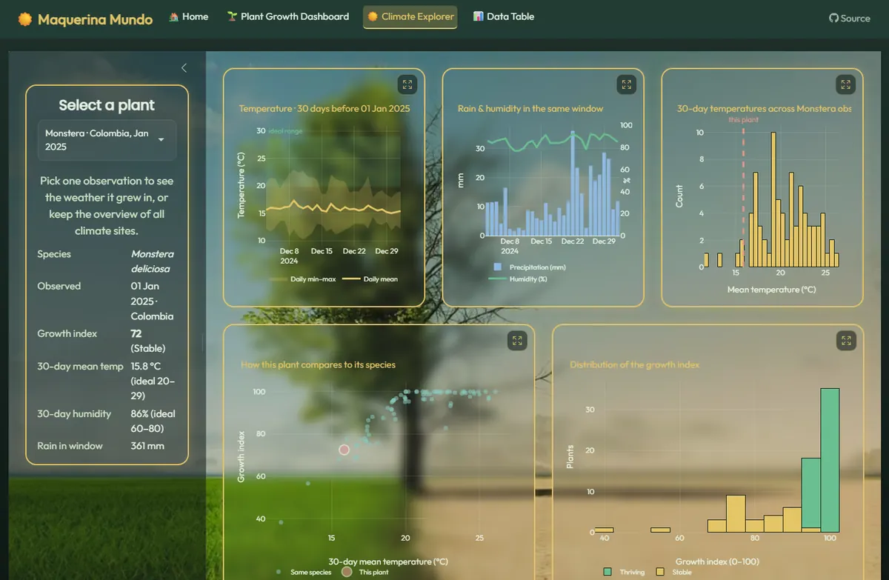

# ☀️ Maquerina Mundo — Plants Meet Climate

*Modeling the harmony between nature, climate, and machines.*

[](https://github.com/manofmanana/Plant-and-Climate-Shiny-Dashboard/actions/workflows/ci.yml)


**[Live app](https://manofmanana.shinyapps.io/maquerinamundo/)** · **[Video walkthrough](https://www.youtube.com/watch?v=I6cCEDqALec)**

Maquerina Mundo is a solarpunk-inspired Shiny dashboard. It connects **where popular houseplant species are observed around the world** (GBIF) with **the real weather around each observation** (Open-Meteo), and asks a simple question: *how favourable was that climate for that plant?*

It grew out of a love for plants, hiking and the outdoors, and a wish to make climate data feel accessible and hopeful.


## What's inside

**🌱 Plant Growth Dashboard**
- Filter by species and by minimum 30-day humidity; every chart, stat and the map update together
- Growth index by species, humidity vs growth, and a *"what drives the growth index?"* correlation chart
- World map of all observations, clustered and coloured by Thriving or Stable, with details in each popup
- Monthly growth trend per species, and observation counts



**☀️ Climate Explorer**
- **Overview:** daily, weekly and monthly climate averaged over 30 reference sites (Jan 2021 – Oct 2026)
- **Single plant:** pick any of the 593 observations to see the temperature it experienced (with the species' ideal range shaded), rain and humidity in the same window, and how it compares to every other plant of its species



**📊 Data Table**: search, sort and filter every column, then download as CSV or Excel.

Every chart has an **expand** button for a full-screen view (close with ✕, Escape, or a click outside).

## The data

| Dataset | Source | Contents |
|---|---|---|
| `data/indoor_plants.csv` | [GBIF](https://www.gbif.org/) occurrence records | 593 observations of 9 houseplant species in 63 countries, Jan 2025 – Oct 2026 |
| `data/plant_climate_daily.csv` | [Open-Meteo](https://open-meteo.com/) historical archive | Daily weather at each plant's location for the 30 days up to its observation date |
| `data/climate_data.csv` | Open-Meteo | Daily weather at 30 reference sites, 2021 – Oct 2026 |
| `data/points_for_climate.csv` | — | Coordinates of the reference sites |

Weather variables: mean/min/max temperature, precipitation, wind, relative humidity and solar (shortwave) radiation.

### About the growth index

GBIF records **where and when** a plant was seen, not how fast it grew. So instead of inventing growth numbers, the app computes a transparent **modeled growth index (0–100)** in [`R/growth_model.R`](R/growth_model.R):

```
growth_index = 100 × temperature_score^0.5 × humidity_score^0.3 × light_score^0.2
```

Each score is 1 when the 30-day average sits inside that species' commonly cited care range (e.g. Monstera 20–29 °C, 60–80 % humidity), and falls linearly to 0 outside it. Light saturates at 15 MJ/m² per day. Plants at or above the median are labelled **Thriving**, the rest **Stable**.

It's an illustrative model of *how favourable the local outdoor climate was*, not a measurement, and the app says so wherever it's shown. With the current data, temperature is the strongest driver (r ≈ 0.56), followed by sunlight (r ≈ 0.45).

## Run it locally

Requires R ≥ 4.1.

```r
# from the project folder, in R
install.packages("pak")
pak::local_install_deps()          # installs everything listed in DESCRIPTION
shiny::runApp()
```

Or from a terminal: `Rscript -e "shiny::runApp(launch.browser = TRUE)"`.

## Tests

```bash
Rscript tests/testthat.R
```

The suite covers data loading (deterministic and read-only), the growth model, the analysis helpers and every chart, including empty-data cases and HTML escaping in map popups. It also has an end-to-end test that starts the real app in headless Chrome with **shinytest2** and drives every tab. GitHub Actions runs it on every push.

## Refreshing the data

```bash
Rscript scripts/build_data.R            # refresh climate for the current plants
Rscript scripts/build_data.R --plants   # also re-download observations from GBIF
```

Open-Meteo is free and needs no API key; the scripts space out requests to respect its rate limits.

## Deploy to shinyapps.io

```r
install.packages("rsconnect")
rsconnect::setAccountInfo(name = "YOUR_ACCOUNT", token = "YOUR_TOKEN", secret = "YOUR_SECRET")  # once, never commit these
rsconnect::deployApp(appName = "maquerinamundo")
```

## Project structure

```
app.R                 UI + server
R/
  data_load.R         reads data/, cleans species names, joins plant climate
  growth_model.R      species care ranges + modeled growth index
  analysis.R          filters and correlations
  plots.R             every chart and the map (plotly / leaflet)
  helpers.R           cards, footer, formatting
www/                  style.css, expand.js, images
data/                 CSV datasets (see above)
scripts/              data refresh: GBIF + Open-Meteo
tests/testthat/       unit tests + shinytest2 end-to-end test
docs/                 README screenshots
```

## Built with

Shiny · bslib (Bootstrap 5) · plotly · leaflet + OpenStreetMap · DT · dplyr · lubridate · testthat · shinytest2

## License & credit

MIT, see [LICENSE](LICENSE). Created by **Alejandro (Alex) Ines**; please credit the author when reusing or adapting this work. Plant occurrence data © GBIF contributors; weather data from Open-Meteo (CC BY 4.0); map tiles © OpenStreetMap contributors.
